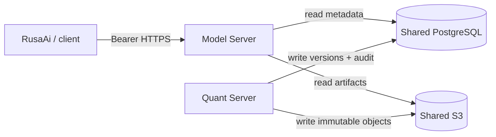
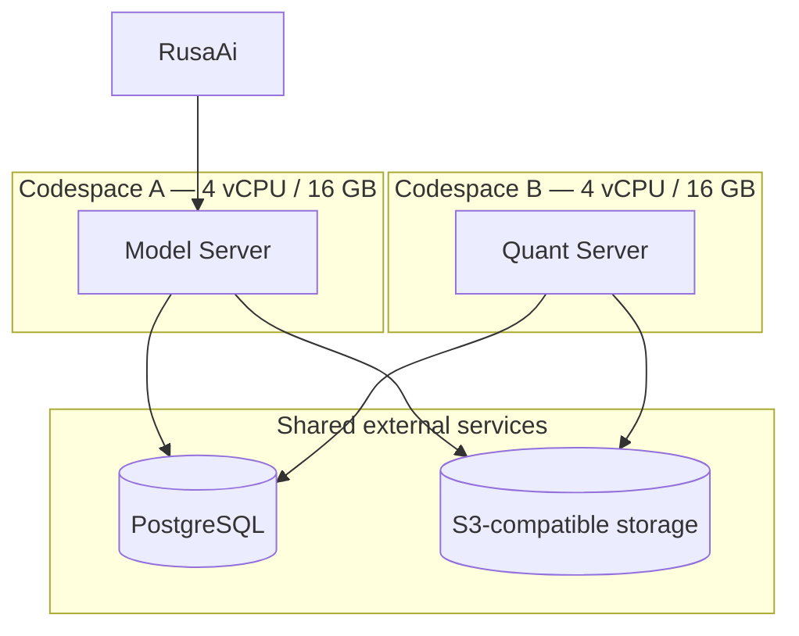

# RusaModels Architecture

RusaModels is an independent model infrastructure platform. RusaAi is an authenticated client and remains responsible for agent orchestration and workflow state.

- **Model Server:** model lifecycle and inference gateway boundary; reads model metadata and immutable artifacts.
- **Quant Server:** conversion and quantization boundary; writes immutable artifacts and registers model versions.
- **Shared control plane:** PostgreSQL stores registry metadata, versions and append-only audit events. S3-compatible storage stores model files.
- **Development adapters:** SQLite and local filesystem are restricted to development and tests.

Both Codespaces receive the same external DATABASE_URL, S3_ENDPOINT_URL, S3_BUCKET and S3 credentials. They must not provision independent databases or artifact buckets.

## Registry model

- model_catalog: model identity, publisher, architecture, license and source.
- model_versions: immutable version, source revision, precision and manifest digest.
- artifacts: immutable storage key, size and SHA-256.
- audit_events: actor, role, action, resource, timestamp, outcome and request ID.

Production schema changes use Alembic migrations. Application startup does not call create_all.

## Security

- API tokens are represented by SHA-256 digests in configuration.
- Viewer, Manager and Administrator permissions are checked server-side.
- Service-to-service authentication uses a separate token digest.
- PostgreSQL/SQLite triggers reject audit UPDATE and DELETE.
- Artifact keys are normalized and traversal-checked; writes reject existing keys and validate SHA-256.
- Production requires PostgreSQL and S3-compatible storage.
- Production IAM should grant Model Server read-only object permissions and Quant Server narrowly scoped write permissions.
